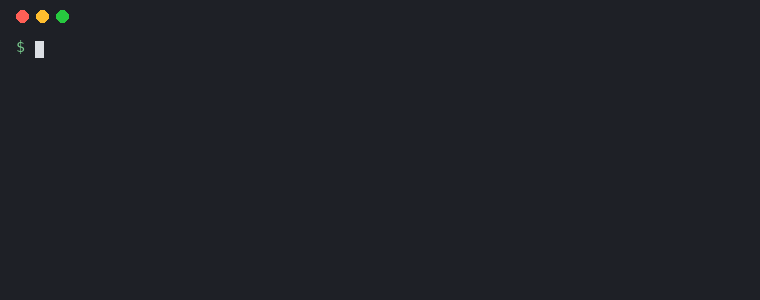
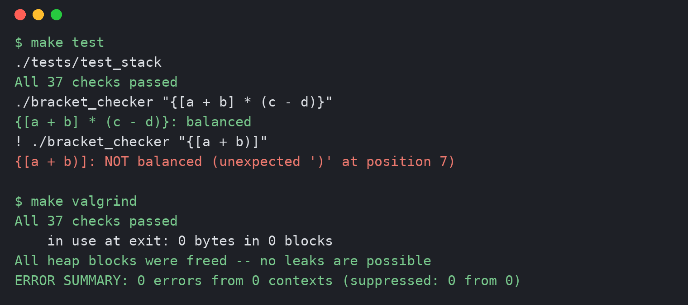

# bracket-validator-c

A command-line tool in C that checks whether the brackets in an expression are balanced and, when they are not, tells you where it went wrong.

[](https://github.com/bcpasaoglu/Balanced-Parentheses-Stack-in-c/actions/workflows/ci.yml)


[](LICENSE)




## Why I built this

I started this as a learning project to practise data structures in C. Checking brackets is the classic problem a stack solves, and doing it in C meant writing the stack myself: a linked list, every `malloc` matched with a `free`, and code split into a header and a source file.

The first version worked, but it was rough. It called `exit(1)` from inside the stack code, read input with `scanf("%s")` (so `(a + b)` was cut off at the first space), and leaked memory when it stopped early. Fixing those became the more interesting part of the project, so I added tests, memory checks and CI to make sure they stay fixed.

## Features

- Checks `()`, `[]` and `{}`; every other character is ignored.
- Points to the first problem: the position of an unexpected closing bracket, or an opening bracket that is never closed.
- Takes expressions as arguments, or reads one line of any length from standard input.
- Exit codes for scripts: `0` balanced, `1` not balanced, `2` error.
- No memory leaks, including when the check stops early. Verified with valgrind and AddressSanitizer.

## Example runs

```console
$ ./bracket_checker "{[a + b] * (c - d)}"
{[a + b] * (c - d)}: balanced

$ ./bracket_checker "{[a + b)]" "(a + b"
{[a + b)]: NOT balanced (unexpected ')' at position 7)
(a + b: NOT balanced (unclosed bracket at end of input)

$ echo "f(x[i]) + g{y}" | ./bracket_checker
Enter expression: f(x[i]) + g{y}: balanced

$ ./bracket_checker "(]" ; echo "exit code: $?"
(]: NOT balanced (unexpected ']' at position 1)
exit code: 1
```

Positions start at 0. With several arguments, the exit code is the worst result among them.

## How it works

The expression is scanned once, left to right:

1. An opening bracket is pushed onto the stack.
2. A closing bracket pops the top of the stack. If the stack is empty, or the popped bracket is not the matching type, the expression is not balanced and the current index is reported.
3. At the end, the stack must be empty. If it is not, some bracket was never closed.

```
input:  {  [  a  +  b  )  ]
index:  0  1  2  3  4  5  6

'{'  push        stack: {
'['  push        stack: { [
')'  pop '['     '[' does not match ')'  ->  NOT balanced at position 5
```

This runs in **O(n)** time for an expression of length n, and uses **O(d)** extra memory, where d is the deepest nesting level.

The stack is a singly linked list with a header node: `s->next` is the top. Push and pop both work at the head, so they are O(1) and never need to move other elements.

```
stack.h / stack.c   stack type, push/pop/top, CheckBrackets()
main.c              CLI: arguments or one line from stdin, exit codes
tests/test_stack.c  unit tests
Makefile            build, test, valgrind and sanitizer targets
```

## Build and run

You need a C11 compiler (gcc or clang) and `make`. Valgrind is optional.

```bash
git clone https://github.com/bcpasaoglu/Balanced-Parentheses-Stack-in-c.git
cd Balanced-Parentheses-Stack-in-c

make                 # builds ./bracket_checker
./bracket_checker "{[()]}"

make test            # unit tests + CLI smoke tests
make valgrind        # unit tests under valgrind, fails on any leak
make sanitize        # unit tests built with AddressSanitizer + UBSan
```

Everything is compiled with `-std=c11 -Wall -Wextra -Wpedantic -Werror`, so a new warning breaks the build. CI runs all of the above with both gcc and clang on every push and pull request.



## Technical decisions

- **Status codes instead of `exit()`.** Library code should not end the program. `PushStack`, `PopStack` and `TopOfStack` return `STACK_OK`, `STACK_EMPTY` or `STACK_NO_MEMORY` and hand values back through out-parameters, so the caller decides what an error means. Running out of memory, for example, is reported as exit code `2` instead of a crash.
- **A linked list instead of an array.** It never needs resizing, and it was the point of the exercise. The cost is one `malloc` per opening bracket. A growing array would be faster for very deep input, which is the first thing I would change if speed mattered.
- **The stack is cleared before and after every check.** When a mismatch stops the scan early, the remaining nodes are freed right away. The same stack can be reused for the next expression, and there is a test for exactly that case.
- **Reading input into a growing buffer.** `scanf("%s")` stopped at spaces and could overflow a fixed buffer. The CLI now reads characters into a buffer that doubles when full, so line length has no limit.
- **Tests that run without any framework.** A small `CHECK` macro counts failures and keeps going, so one run shows every broken case. The tests include edge cases such as an empty string, a lone `)`, mixed types like `(]`, and 100,000 levels of nesting.

## Known limitations

- Brackets inside string literals or comments are counted too, so `printf("(");` is reported as not balanced.
- Only `()`, `[]` and `{}` are recognised. Angle brackets are ignored.
- Positions are byte offsets, so with multi-byte UTF-8 characters they do not match the visible column.
- Standard input is read as a single line. To check several expressions, pass them as arguments.

## License

MIT. See [LICENSE](LICENSE).
